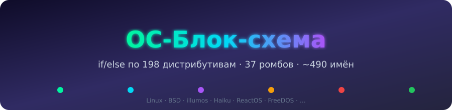
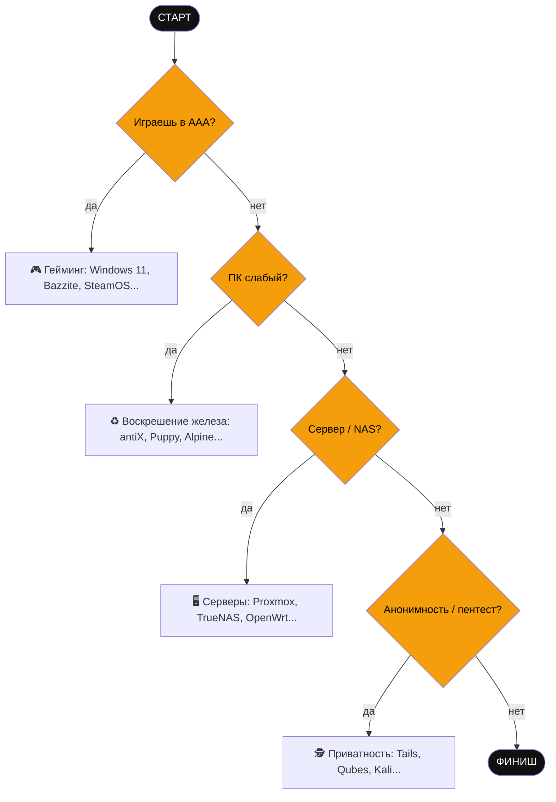

<p align="center">
  
</p>

<p align="center">
  
  
  
  
  
</p>

<p align="center">
  <a href="flowchart.svg"><b>Открыть SVG</b></a> ·
  <a href="flowchart.png"><b>PNG</b></a> ·
  <a href="flowchart.pdf"><b>PDF</b></a> ·
  <a href="flowchart.mmd"><b>Mermaid</b></a> ·
  <a href="flowchart.dot"><b>Graphviz</b></a>
</p>

<details>
<summary><b>🎬 Мини-превью графа (Mermaid)</b></summary>



</details>

---

# Блок-схема «Какую ОС ставить?» — if/else по дистрибутивам

Классическая блок-схема выбора операционной системы: старт → цепочка ромбов
`if/else` → прямоугольник с дистрибутивом. Стереотипы в названиях — в комплекте.

**Масштаб: 198 блоков-ответов, 37 ромбов-вопросов, ~490 названий систем.**
Источник названий — Википедия: статья
[«List of Linux distributions»](https://en.wikipedia.org/wiki/List_of_Linux_distributions)
(263 имени в 17 разделах), статья
[«List of BSD operating systems»](https://en.wikipedia.org/wiki/List_of_BSD_operating_systems)
(36 имён) и та самая «превосходная фотография» —
[таймлайн дистрибутивов Linux](https://commons.wikimedia.org/wiki/File:Linux_Distribution_Timeline_Dec._2020.svg)
(642 метки). Точная сверка скриптом (`wiki_raw/analyze_coverage.py`): из 299 имён
обеих статей-списков в схеме есть 275 (~92%). Сырые данные лежат в `wiki_raw/` (`distros.json`,
`coverage_report.txt`, сам `timeline.svg`).

## Файлы

| Файл | Что это |
|---|---|
| `flowchart.svg` | **Главная версия.** Вектор, зум без потери качества. Открыть в браузере и масштабировать |
| `flowchart.png` | Растр ~16 000 px (рендер из SVG через rsvg). Для печати и отправки |
| `flowchart.pdf` | Вектор для печати (крупный формат) |
| `flowchart.dot` | Исходник Graphviz. Правится текстовым редактором, рендерится `dot` |
| `flowchart.mmd` | Тот же граф в Mermaid (10 subgraphs по веткам) — для GitHub, Notion, Obsidian |
| `wiki_raw/` | Данные из Википедии + скрипты сбора (`fetch_wiki.py`, `analyze_coverage.py`) |

## Как читать схему

- **Чёрный овал** — СТАРТ / ФИНИШ.
- **Жёлтый ромб** — магистральный вопрос. «Нет» ведёт **вниз по цепочке**,
  «да» — **вбок**, в свою подветку. У ромба `D10` три выхода: да / нет / «музей?».
- **Оранжевый ромб** — уточняющий вопрос внутри ветки.
- **Цветной прямоугольник** — ответ: дистрибутивы + короткий стереотип.
- **Серая заливка** — мёртвые легенды (проекты закрыты, но их надо знать).
- **Сплошная стрелка** — `if/else` (`да` / `нет` подписаны).
- **Пунктирная стрелка** — «или» (равноценная альтернатива рядом).
- **Цветная рамка** — одна ветка (10 штук): всё внутри связано локально.
  Схема построена **цепочкой, а не звездой** и читается как **вертикальный
  плакат-лесенка сверху вниз**: СТАРТ → гейминг → железо → сервер →
  приватность → творчество → разработка → офис → просто/сам → экзотика → ФИНИШ
  (порядок задан невидимыми рёбрами в `flowchart.dot`, блока-центра нет).
  Mermaid-версия (`flowchart.mmd`, `TD`) вертикальна по построению.

Подписи короткие: вопросы — 2–3 слова, стереотипы — 2–4 слова.

## Маршрут за 30 секунд (магистраль)

1. Играешь в AAA? → гейминг
2. ПК слабый (≤8 ГБ, 10+ лет)? → воскрешение железа
3. Сервер / NAS / homelab? → серверы + NAS + роутеры
4. Анонимность / пентест? → приватность (включая телефоны!)
5. Монтаж / музыка / дизайн? → творчество
6. Кодишь? → разработка
7. Нужны 1С / Office / Photoshop? → офис (включая госы/ФСТЭК)
8. Apple + есть деньги? → macOS / Hackintosh / Asahi
9. «Просто работает» или «сам настрою»? → два больших дерева Linux
10. Экзотика / ретро / музей (BSD, illumos, Haiku, деды 1992 года)

## Покрытие по веткам

**Гейминг:** Windows 11, AtlasOS, Bazzite, ChimeraOS, SteamOS, HoloISO, Nobara,
CachyOS, Garuda, Pop!_OS, PikaOS, SuperGamer, Chapeau, Ultimate Edition.
**Железо:** TinyCore, Puppy, PuppyRus, Legacy OS, Macpup, Quirky, PUD, antiX, Alpine,
Chimera Linux, KolibriOS, Damn Small, Feather, MuLinux, Austrumi, SliTaz, 4MLinux,
Tiny SliTaz, LinuxConsole, DeLi, DeLicate, ConnochaetOS, Monkey, Knopperdisk, DOSLINUX,
SystemRescue, grml, Finnix, Knoppix, DRBL, Parted Magic, tomsrtbt, Refracta,
Rescatux, Super Grub2 Disk, RIP, Stresslinux, PloP, Resulinux, Morphix, Quantian,
DNALinux, ParallelKnoppix, Kaella, Demolinux, Lubuntu, Xubuntu, Bodhi, Linux Lite,
LXLE, Peppermint, Fluxbuntu, Greenie, Runtu, TinyMe, U-lite, Simplicity, Snowlinux,
SalineOS, ToriOS, Emmabuntüs, Eeebuntu, Joli, Jolicloud, gOS, EasyPeasy, Cub,
Netbook, Linpus, MX, Q4OS, Zorin Lite, SparkyLinux.
**Сервер/сеть:** Proxmox VE, PelicanHPC, RancherOS, Container Linux, TrueNAS SCALE,
OpenMediaVault, Unraid, CasaOS, TurnKey, Univention, Amahi, BlueOnyx, Zentyal,
SME Server, IPCop, Elastix, ClarkConnect, Untangle, Annvix, Nitix, Trustix,
Raspberry Pi OS, Raspbian, Twister, DietPi, Arch ARM, Flint OS, OSMC,
LinHES, GeeXboX, LinuxMCE, LibreELEC, MythDora, KnoppMyth, XigmaNAS, m0n0wall,
Openfiler, Rockstor, OviOS, Rocky, Alma, RHEL, CentOS, Oracle, Scientific, Rocks,
CERN, PUIAS, Springdale, Tao, Amazon Linux, CloudLinux, Korora, Kororaa,
Yellow Dog, Red Flag, Asianux, Miracle, Fermi, ClearOS, SUSE, SLES, Debian,
Ubuntu Server, Devuan, OPNsense, pfSense, OpenWrt, VyOS, Vyatta, DD-WRT, IPFire,
Endian, Coyote, FREESCO, BrazilFW, LEDE, FreeBSD, OpenBSD.
**Приватность/взлом/телефоны:** Tails, LPS, Tinfoil Hat, EnGarde, Devil-Linux,
Openwall, Liberté, Qubes OS, Heads, Septor, TorBOX, Kali, Parrot, BlackArch,
Athena OS, BackBox, SecUntu, Kali NetHunter, Damn Vulnerable, Ophcrack, BackTrack,
Auditor, WHAX, GnackTrack, Matriux, Network Security Toolkit, SELKS, NetSecL,
Secureblue, Whonix, Kodachi, Kicksecure, GrapheneOS, CalyxOS, LineageOS, /e/,
Ubuntu Touch, Replicant, DivestOS, CopperheadOS, Mobian, OmniROM, Paranoid,
Resurrection, Sailfish, KaiOS, Maemo, postmarketOS, Asteroid OS, LuneOS, MeeGo,
Mer, Moblin, Tizen, Firefox OS, CyanogenMod, Ubuntu Mobile, Cyanogen OS,
MeeGo Harmattan, Jlime, OpenZaurus, Emdebian, LEAF, CAINE, DEFT, Santoku.
**Творчество:** macOS, AV Linux, Daphile, AudioPhile, GNUGuitarINUX, Moode,
Snakeoil, Ubuntu Studio, Fedora Jam, Musix, dyne:bolic, Dream Studio, ArtistX,
DeMuDi, Mediainlinux, 64Studio, Tango Studio, APODIO.
**Разработка:** Arch, EndeavourOS, Arco, Antergos, Archcraft, ArchBang, ArchLabs,
KaOS, Omarchy, BBQLinux, Bridge, Newtoos, KahelOS, Chakra, Frugalware, Hyperbola,
PacBSD, NixOS, Guix, Void, Artix, Obarun, Gentoo, Calculate, Sabayon, Toorox,
Funtoo, Pentoo, Fedora WS/KDE, Bluefin, Aurora, Silverblue, Kinoite,
Russian Fedora, Parsidora, Momonga, Ubuntu LTS, Vanilla OS, gLinux, Goobuntu.
**Офис/Windows/Apple:** Win 10 LTSC, Tiny11, Win 11 + WSL2, Astra, ALT, ROSA,
GendBuntu, LiMux, Canaima, Pardus, Pisi, Estrella Roja, Progress, VENENUX, Maya OS,
Bharat OS, Nova, Clip OS, Hanthana, BlankOn, Bayanihan, Red Star OS, macOS,
Hackintosh, Asahi.
**«Просто работает»:** Mint Cinnamon/Edge, Zorin Core, Linux XP, Winux, Redmond,
RoboLinux, Rhino, Mageia, OpenMandriva, PCLinuxOS, Conectiva, Granular, ComFusion,
Mandrake, Unity Linux, Fedora KDE, Ultramarine, elementary OS, Deepin, Elive,
Rxart, Pear OS, Makulu, WattOS, Ulteo, MoonOS, Peach OSI, Sn0wL1nuX, SymphonyOS,
Ubuntu/Kubuntu, Budgie, MATE, Cinnamon, Kylin, Unity, Mythbuntu, neon, Maui,
TUXEDO OS, openSUSE Leap/Tumbleweed, GeckoLinux, Kiwi, Solus, Endless, Edubuntu,
DoudouLinux, PrimTux, Qimo, Phinx, Patinho, Leeenux, TEENpup, LliureX, MAX,
Molinux, Linex, Jarro Negro, Linkat, LinuxTLE, Linux Caixa, Kurumin, Guadalinex,
K12LTSP, K-DEMar, Lihuen, SuliX, Poseidon, Sabily, Vinux, UberStudent, Uncom,
Ubuntu CE, VINUX, Skolelinux, Serpent OS, Evolve OS, ChromeOS Flex, FydeOS,
GalliumOS, ChromeOS, ChromiumOS, CloudReady, NayuOS, Android-x86, Remix OS, Fire OS.
**DIY:** Arch, EndeavourOS, Manjaro, Netrunner, NixOS, Slackware, Gentoo, Void,
Slax, Porteus, Salix, Zenwalk, Vector, Absolute, AgiliaLinux, Plamo, KateOS,
NimbleX, Platypux, ZipSlack, Jurix, Bluewhite64, GoblinX, Draco, CRUX, Kwort, LFS,
Source Mage, GoboLinux, Sorcerer, T2, Exherbo, AryaLinux, Lunar, NuTyX, Bedrock,
Dragora, Clear Linux, paldo, Foresight, MkLinux, rPath, Yoper, Debian Testing,
LMDE, SpiralLinux, Trisquel, PureOS, Parabola, gNewSense, Ututo, Uruk, Gobuntu,
BLAG, Ageless, SolydXK, Parsix, HandyLinux, NepaLinux, Sunwah, Libranet,
Webconverger, Point Linux, Progeny, Stormix, GNU/kFreeBSD, GNU/NetBSD, Nexenta,
siduction, aptosid, Rebellin, Tanglu.
**Экзотика/музей:** Batocera, Lakka, Linux for PS2, Buffalo, Red Ribbon,
Commodore OS, ReactOS, FreeDOS, FreeBSD, OpenBSD, NetBSD, GhostBSD, MidnightBSD,
NomadBSD, TrueOS, DesktopBSD, FuguIta, MirOS, DragonFly BSD, BSDTahoe,
OpenIndiana, OmniOS, SmartOS, SerenityOS, 9front, Haiku, MCC, Softlanding, Yggdrasil,
Corel, MEPIS, CrunchBang, Kanotix, BLAG, ASPLinux, Aurox, Fuduntu, Dreamlinux, OpenGEU,
Pinguy, Sun JDS, Caldera, Turbolinux, Vine, Red Hat, SCO, LinuxPPC, MintPPC,
Slackintosh, BunsenLabs, CrunchBang++, Xandros, Linspire, Lindows, Freespire, Lycoris.

## Честные исключения (не влезли поштучно)

Встраиваемые/проприетарные (не ставятся): Junos, IronPort, CellOS, Orbis OS,
MontaVista, Prevas, Nura, Smallfoot, Nokia-инфраструктура, Android Things/Wear,
Project Ballantin/Brillo.
Ультра-редкие синглы из хвоста таймлайна: KaarPux, Danix, Dizinha, Eurielec,
ATmission, Arabian, ASLinux, Aquamorph, Asturix, Ataraxia, B2D, Bardinux, Baruwa,
Beehive, Berry, Best, Black Lab, BluePoint, Bogus, Buhawi, Burapha, Craftworks,
DARKSTAR, DILINUX, DLD, DeadCD, Descent, ELX, ELinOS, Ekaaty, Enoch, Epidemic,
Eridani, Everest, Hedinux, Hiweed, Hiwix, HostGIS, Imagineos, Independence,
KaeilOS, Kalango, Kondara, Kongoni, LBA, LST, Leka, Librassoc, Linvo, Liquid Lemur,
LuninuX, MNIS, MOPSLinux, Madbox, Medialinux, Metamorphose, Midori, Mini, Minislack,
Monomaxos, Natures, NeoDizinha, NetStation, OS4, Octoz, Ojuba, Omoikane, OpenSLS,
PC OS, Papug, Pingo, Plamo (есть!), Porteus Kiosk, QiLinux, Qomo, RR4, SAM, SAMity,
SL4P, SLAMPP, SMS, SOT, STUX, ServOS, Shift, Simplis, SlaXBMC, Slack 390, Slackel,
Slamd64, Sophos, Specifix, Splack, Stampede, Stephenson's Rocket, Stux, Synergy,
TAMU, Topologilinux, Trans-Ameritech, UHU, Uberyl, Unifix, VLOS, Wolvix, Yoper
(есть!), AOSC OS, ARMedslack, Bluestar, Kwort (есть!), Maui (есть!), Minislack,
Thinstation, Semplice, SOT, Refracta (есть!), White Box (см. SCO-бокс),
Think Blue, Gentoo/NetBSD, Gentoo/OpenBSD, adJ, Anonym.OS, Bitrig, HyperbolaBSD,
FreeSBIE, PicoBSD, AskoziaPBX, TrustedBSD, XORP, Ubuntu GNOME (влит в Ubuntu),
Ubuntu JeOS, Fedora Core (та же Fedora), LRP, fli4l, SmoothWall, Sentry,
Gibraltar, Astaro, Gibraltar, Buffalo (есть!), Raspbmc/Raspyfi (предки OSMC),
OS2005, Kororaa (есть!), Springdale (есть!), Tao (есть!), PUIAS (есть!),
The Linux For Schools Project.
Данные по ним сохранены в `wiki_raw/distros.json` — если какой-то нужен именным
блоком, скажи, добавлю.

## Как перерисовать после правок

```bash
dot -Tsvg flowchart.dot -o flowchart.svg
python3 wiki_raw/svg_label_backing.py   # белые подложки под подписями
rsvg-convert -w 16000 flowchart.svg -o flowchart.png   # шире 16384 px не открывают часть вьюверов
rsvg-convert -f pdf flowchart.svg -o flowchart.pdf
```

Нужен Graphviz (`sudo apt install graphviz`). Кириллица — шрифт DejaVu Sans.
Mermaid-версию (`flowchart.mmd`) можно проверить на https://mermaid.live.

## Идея дизайна

- Один ответ = один прямоугольник; каждый прямоугольник — терминальный.
- Все линии ортогональные (`splines=ortho`): только горизонтали и вертикали
  под прямым углом, как в ГОСТ-блок-схемах. Подписи да/нет/«или» вынесены
  в `xlabel` (обычные `label` орто-роутер не умеет).
- Цветовое кодирование линий: тёмные сплошные — решения да/нет,
  бирюзовые пунктирные — альтернативы «или». Подписи жирные, в цвет своей линии.
- Каждая подпись лежит на белой пилюле-подложке (скрипт `wiki_raw/svg_label_backing.py`
  правит SVG после рендера), поэтому никакая линия не пересекает текст.
- Цепочки «или» — короткие и строго внутри своей ветки-кластера.
- В экзотику ведут только 2 коротких входа снизу (от openSUSE и Debian) + «музей»
  третьим выходом D10 — длинных диагоналей через полсхемы нет.
- Мёртвые, но легендарные проекты — серым: BackTrack, CrunchBang, Mandrake,
  Red Hat 9, MCC 1992 года и другие. История тоже ставится... ну, почти.
